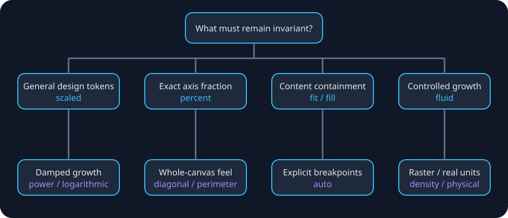

# Scaling strategy catalog

[Documentation hub](README.md) · [Mathematics](MATHEMATICS-AND-CALCULUS.md) · [API](API.md)

Every strategy answers a different design question; they are not quality levels. Begin with **scaled**, measure the mismatch, and adopt another curve only when its invariant matches the requirement.



## Selection matrix

| Requirement | Recommended | Avoid / warning |
|---|---|---|
| General spacing, radii, controls | [scaled](strategies/scaled.md) | Linear growth may be strong on desktop |
| Explicit conditional tokens | [auto](strategies/auto.md) | Do not recreate device-model tables |
| Raster buffer or pixel API | [density](strategies/density.md) | Never use as SwiftUI/UIKit points; ignores window size |
| Two-axis canvas perception | [diagonal](strategies/diagonal.md), [perimeter](strategies/perimeter.md) | Tall windows affect size |
| Entire reference canvas visible | [fit](strategies/fit.md) | Empty margins are expected |
| Reference canvas covers boundary | [fill](strategies/fill.md) | Cropping is expected |
| Hard minimum/maximum growth between 320 and 768 points | [fluid](strategies/fluid.md) | Bounds are fixed; check they match the product |
| Partial responsiveness | [interpolated](strategies/interpolated.md) | Fixed 50 % blend, still unbounded |
| Strong large-screen damping | [logarithmic](strategies/logarithmic.md) | Validate very small synthetic windows |
| Literal percentage of an axis (`spaceW`, `spaceH`) | [percent](strategies/percent.md) | Protect accessibility minima |
| Smooth damped growth | [power](strategies/power.md) | Exponent is fixed at 0.75 and cannot be tuned |
| Largest size that fits measured content | [resize](strategies/resize.md) | Predicate must be monotonic |
| Print/calibrated measurement | [physical units](strategies/physical-units.md) | Display scale is not PPI |

## Runtime selection example

```swift
import AppDimensDynamic

let c = DimensConfiguration(screenWidth: 1024, screenHeight: 768)
let prefersBoundedGrowth = true
let strategy: DimensStrategy = prefersBoundedGrowth ? .fluid : .scaled
let options = StrategyOptions(qualifier: .width)
let gutter = DynamicDimens.resolve(16, strategy: strategy, configuration: c, options: options)
// 19.2 with .fluid (width 1024 is above the 768 band); 54.6 with .scaled
```

## Common options

`StrategyOptions` has five fields. `qualifier` selects smallest width, width, or height. `inverter` changes axis selection under an orientation rule. `applyAspectRatio` adds aspect-ratio correction: for `scaled` and `percent` it changes the slope of the linear curve, and for the other strategies it multiplies the result by `1 + k·ln(AR/1.78)`. `sensitivityK` replaces the default `k = 0.08/30`. `ignoreMultiWindows` returns the raw design value for constrained windows.

The curve constants are fixed and are not options: the power exponent (0.75), the fluid band (320 to 768 points) and range (×0.8 to ×1.2), the interpolation blend (50 %), and the auto breakpoint (480 points). Diagonal, perimeter, fill, fit, and density ignore `qualifier`, because they read both window sides or the display scale.

## A repeatable selection process

1. State the invariant in plain language: "10% of width," "never crop," or "stop growing after 768 points."
2. Choose the row that encodes that invariant mathematically.
3. Calculate expected values at the reference, smallest supported window, and largest supported window.
4. Validate rotation, split view, Dynamic Type, and live resize.
5. Store strategy options beside design tokens so tuning remains consistent.

See each linked page for equations, worked arithmetic, Swift examples, recommendations, and failure modes.
